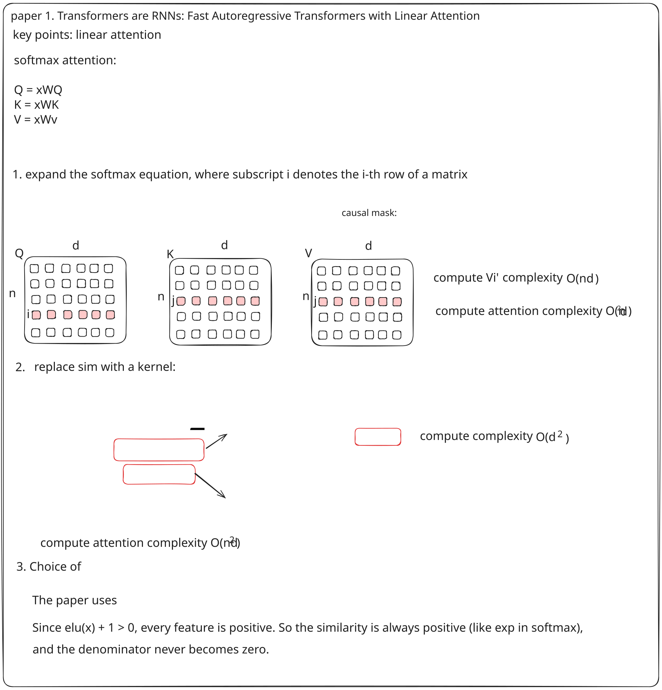
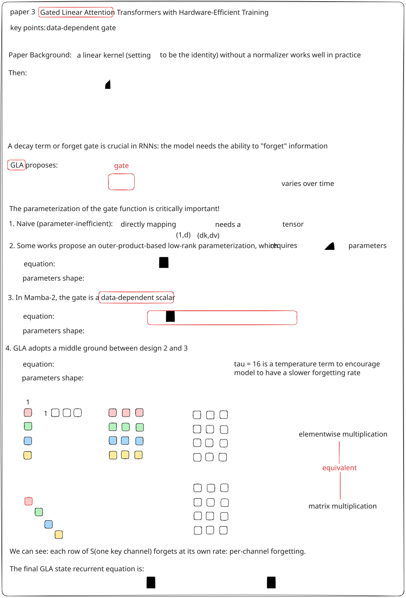

In the age of AI, everything below is handcrafted!!!

If you follow open-source models, you may have noticed that several recent foundation models use linear attention, such as [**Kimi K3**](https://huggingface.co/moonshotai/Kimi-K3), [**Kimi K3.1 Pro**](https://huggingface.co/moonshotai/Kimi-K3.1-Pro), and [**Qwen3.8-Flash-Next**](https://huggingface.co/Qwen/Qwen3.8-Flash-Next).

I will use a series of concise, hand-drawn explanations to explore representative work on linear attention.

Each post distills one original paper, and the posts build on one another logically. By the end, you should have a solid understanding of today's most important linear-attention mechanisms—Kimi Delta Attention (KDA) and Gated DeltaNet—and be better prepared to follow how model architectures are evolving.

Feedback is welcome at flying_xf@icloud.com.

# Blog 1

I want to start from the very beginning: the paper ["Transformers are RNNs: Fast Autoregressive Transformers with Linear Attention"](https://arxiv.org/abs/2006.16236).

The main contribution of this paper is a new kernel function that replaces the original softmax function. This decouples q and k and yields a computation method with O(nd²) complexity, where n is the sequence length and d is the hidden dimension.

# Blog 2

The second post is about ["Linear Transformers Are Secretly Fast Weight Programmers"](https://arxiv.org/abs/2102.11174). Drawing on the **delta rule** proposed in early AI papers, it interprets linear attention as a key-value associative memory model and proposes **Delta Networks**.

# Blog 3

The third post is about ["Gated Linear Attention Transformers with Hardware-Efficient Training"](https://arxiv.org/abs/2312.06635). Its central idea is a **data-dependent gate** that lets the recurrent state forget information over time.

The key design problem is how to parameterize this gate. A naive formulation can be parameter-inefficient; low-rank and scalar alternatives make different trade-offs; and GLA chooses a middle ground that supports efficient training. In the final recurrent equation, each key channel forgets at its own rate, giving the model per-channel forgetting.

Beyond the gating formulation itself, the paper also tackles a systems question: how to reorganize linear-attention computation for greater parallelism. This series focuses on algorithms; I may cover operator-level implementations in a separate systems-oriented series.

# Blog 4

The fourth post is about ["Gated Delta Networks: Improving Mamba2 with Delta Rule"](https://arxiv.org/abs/2412.06464). It combines two ideas from the previous posts: the **delta rule** from Blog 2 and the **gate rule** from Blog 3.

The result is a gated delta rule that preserves the correction behavior of the delta rule while adding a data-dependent forgetting mechanism. This direction leads naturally to later architectures such as ["Kimi Linear: An Expressive, Efficient Attention Architecture"](https://arxiv.org/abs/2510.26692), which combines channel-wise gating with per-head scalar decay.

